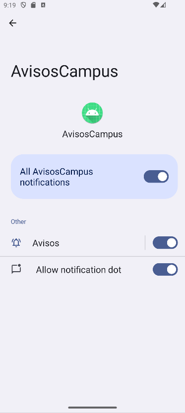
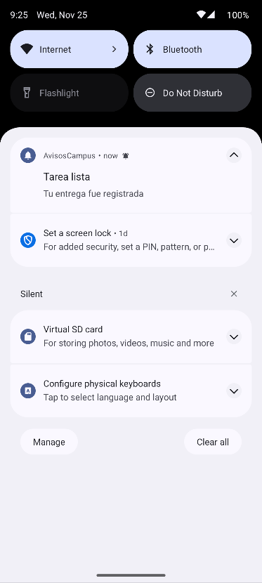
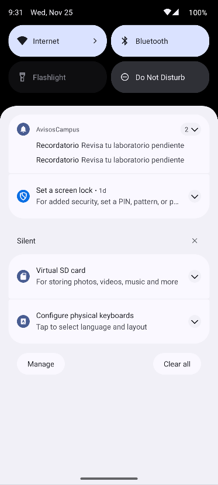
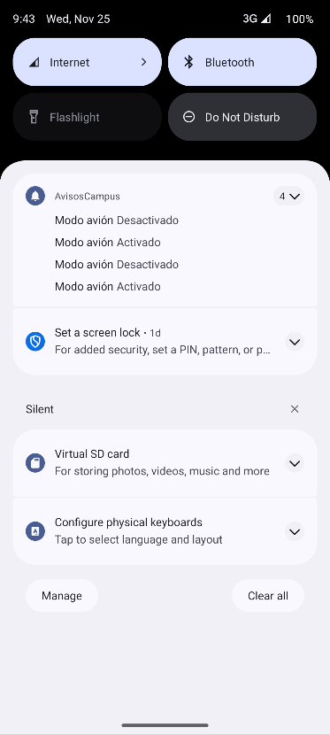
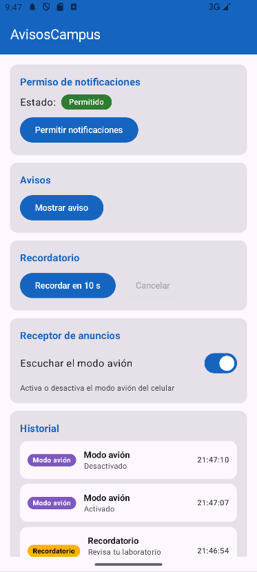
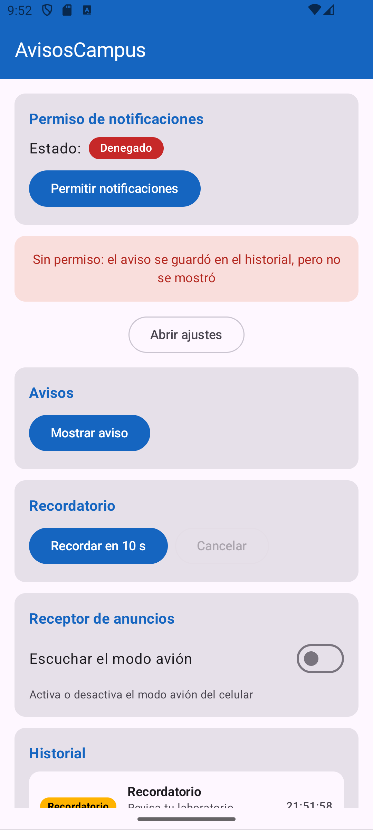

# AvisosCampus

App Android que muestra notificaciones locales y escucha lo que pasa en el celular. Con un botón muestra un aviso, con otro programa un recordatorio que llega a los 10 segundos y, si se activa el receptor, avisa cuando el usuario activa o desactiva el modo avión. Cada aviso queda anotado en un historial.

Laboratorio 15 · Notificaciones · Programación en Móviles · TECSUP

**Autor:** Farid Chávez Campos

## Tecnologías

- Kotlin + Jetpack Compose + Material 3 (sin XML)
- Notificaciones locales con `NotificationCompat` y canal propio
- Permiso `POST_NOTIFICATIONS` en tiempo de ejecución (Android 13+)
- `PendingIntent` inmutable para abrir la app al tocar la notificación
- Corrutinas (`viewModelScope`, `delay`, `Job`) para el recordatorio
- `BroadcastReceiver` registrado en tiempo de ejecución para el modo avión
- Arquitectura MVVM + Repository (interface)

## Funcionalidades

| Función | Descripción |
|---|---|
| Canal | Se crea el canal **Avisos** una sola vez en la clase `Application` |
| Permiso | Pide `POST_NOTIFICATIONS` y muestra el estado: **Sin pedir**, **Permitido** o **Denegado** |
| Avisos | **Mostrar aviso** muestra la notificación **Tarea lista**; cada aviso usa su propio id |
| Abrir la app | Al tocar la notificación se abre `MainActivity` y la notificación desaparece |
| Recordatorio | **Recordar en 10 s** con cuenta regresiva *Faltan N s* y opción de **Cancelar** |
| Receptor | Switch **Escuchar el modo avión**; avisa **Activado** o **Desactivado** |
| Historial | Los 20 avisos más recientes arriba, con etiqueta de origen, título, texto y hora |
| Permiso denegado | El aviso se guarda en el historial, se muestra un mensaje y el botón **Abrir ajustes** |

## Estructura de paquetes

```
com.chavez.avisoscampus/
├── AvisosApp.kt
├── MainActivity.kt
├── model/
│   └── Modelos.kt
├── data/
│   └── AvisosRepository.kt
├── notificacion/
│   └── Notificador.kt
├── receiver/
│   └── ModoAvionReceiver.kt
├── viewmodel/
│   └── AvisosViewModel.kt
└── ui/
    ├── PantallaAvisos.kt
    ├── HistorialAvisos.kt
    └── theme/
```

## Arquitectura MVVM

```
View (PantallaAvisos + HistorialAvisos)
   |  eventos: botones, switch            ^  collectAsState()
   v                                      |
ViewModel (AvisosViewModel) --- StateFlow (avisos, permiso, faltan, escuchandoAvion, mensaje) --->
   |  registra el aviso                   |  emite: eventos (SharedFlow<Aviso>)
   v                                      v
AvisosRepository (interface)          View recibe el evento y llama a
   -> AvisosRepositoryMemoria         Notificador.mostrar(context, aviso)
```

| Capa | Conoce a | No hace |
|---|---|---|
| View (`ui/`) | Su ViewModel y el `Notificador` | No decide qué se avisa ni guarda el historial |
| ViewModel | Solo la interface del Repository | No usa `Context`, `NotificationManager` ni `BroadcastReceiver` |
| Repository | Nada de la UI | No usa `Context` |
| Notificador | El sistema (canal, `NotificationManagerCompat`) | No guarda estado de la app |

El ViewModel decide qué avisar, lo registra en el Repository y emite un evento. La pantalla, que sí tiene `Context`, recibe el evento y llama al `Notificador`. Si `mostrar` devuelve `false` por falta de permiso, la pantalla avisa al ViewModel con `noSePudoMostrar()`.

## Capturas

| Canal Avisos | Notificación en el panel | Recordatorio |
|---|---|---|
|  |  |  |

| Modo avión | Historial | Permiso denegado |
|---|---|---|
|  |  |  |

## Pruebas de aceptación

Probado en un emulador Medium Phone con Android 14 (API 34).

| Prueba | Resultado esperado | OK |
|---|---|---|
| Abrir Ajustes → Apps → AvisosCampus → Notificaciones | Existe el canal Avisos | ✅ |
| Pulsar Permitir notificaciones | Aparece el cuadro de Android y la etiqueta cambia | ✅ |
| Pulsar Mostrar aviso | Aparece la notificación Tarea lista | ✅ |
| Pulsar Mostrar aviso dos veces | Aparecen dos notificaciones distintas | ✅ |
| Tocar la notificación | Se abre la app y la notificación desaparece | ✅ |
| Recordar en 10 s | Cuenta regresiva y aviso al llegar a 0 | ✅ |
| Recordar y minimizar la app | El aviso llega igual | ✅ |
| Recordar y cancelar | No llega ningún aviso | ✅ |
| Switch activado y cambiar el modo avión | Aviso Activado y luego Desactivado | ✅ |
| Switch desactivado y cambiar el modo avión | No hay aviso | ✅ |
| Permiso denegado y Mostrar aviso | Mensaje de error, aviso en el historial y la app no se cierra | ✅ |
| Rotar la pantalla durante el recordatorio | La cuenta regresiva continúa | ✅ |
| Revisar el código | No hay Context en `viewmodel/` y todo receptor registrado se quita en `onDispose` | ✅ |

## Para pensar

**1. ¿Por qué una notificación necesita un canal y un permiso? ¿Qué pasa si falta cada uno?**

El canal (Android 8+) agrupa las notificaciones por tipo y le permite al usuario decidir la importancia, el sonido o si las quiere recibir, sin desactivar toda la app. El permiso `POST_NOTIFICATIONS` (Android 13+) existe para que el usuario decida si la app puede mostrarle notificaciones. Si falta el canal, la notificación simplemente no se muestra y el sistema solo deja un aviso en el Logcat. Si falta el permiso, `notify` no muestra nada; por eso `Notificador.mostrar` lo comprueba antes y devuelve `false`, y la app muestra un mensaje en lugar de cerrarse.

**2. ¿Por qué el ViewModel emite un evento y no muestra la notificación él mismo?**

Porque mostrar una notificación necesita un `Context`, y el ViewModel no debe tenerlo: vive más que la Activity y guardar su `Context` provocaría fugas de memoria. Además, así el ViewModel solo tiene lógica (qué avisar y cuándo) y se puede probar sin Android. La pantalla, que sí tiene `Context`, recibe el evento por el `SharedFlow` y llama al `Notificador`. Se usa un `SharedFlow` y no un `StateFlow` porque es un evento de una sola vez: no debe repetirse al rotar la pantalla.

**3. ¿Qué pasa si usas el mismo id en dos notificaciones?**

La segunda reemplaza a la primera: Android actualiza la notificación existente en vez de crear otra. Por eso se usa `aviso.id`, que es distinto para cada aviso, y al pulsar dos veces **Mostrar aviso** aparecen dos notificaciones. Reutilizar el id solo tiene sentido cuando se quiere actualizar una notificación, por ejemplo una barra de progreso.

**4. ¿Por qué `onReceive` debe ser corto y por qué hay que quitar el receptor al salir?**

`onReceive` se ejecuta en el hilo principal; si tarda varios segundos, congela la interfaz y Android puede mostrar un error de "la app no responde". Por eso `ModoAvionReceiver` solo lee el extra `state` y llama a la lambda. El receptor se quita en `onDispose` porque, si queda registrado, conserva una referencia a una pantalla que ya no existe: se filtra memoria y se siguen recibiendo anuncios sin necesidad. Con `DisposableEffect` se registra al activar el switch y se quita al apagarlo, al rotar o al cerrar la pantalla.

**5. ¿En qué casos usarías una notificación local y en cuáles una push de Firebase?**

Una notificación local la genera la propia app en el celular, sin internet: recordatorios, alarmas, el fin de una descarga o un cambio del sistema como el modo avión. Una push de Firebase Cloud Messaging la envía un servidor y llega aunque la app esté cerrada: mensajes nuevos de un chat, avisos del docente, el cambio de estado de un pedido o cualquier evento que ocurre fuera del celular.
